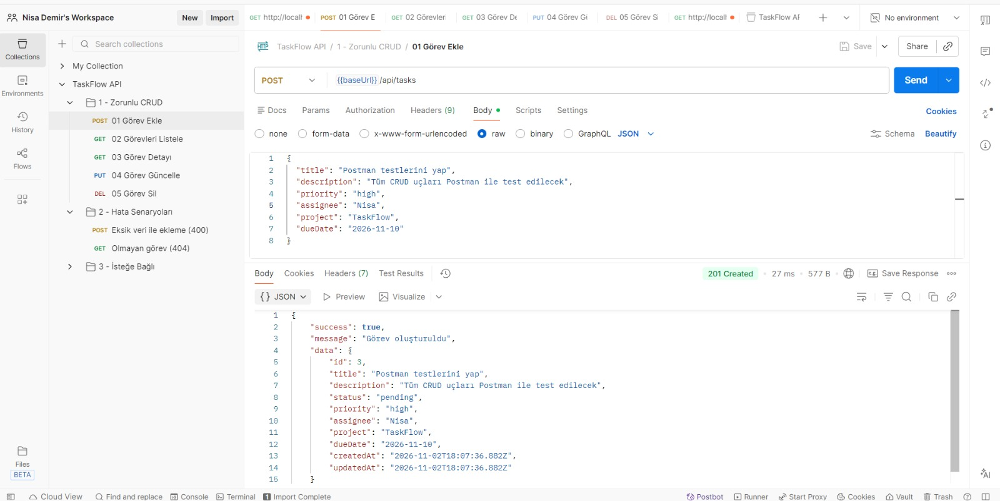
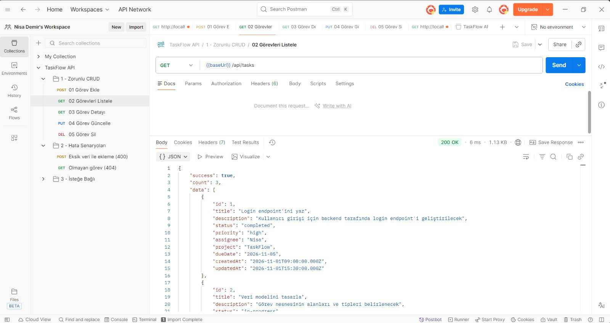
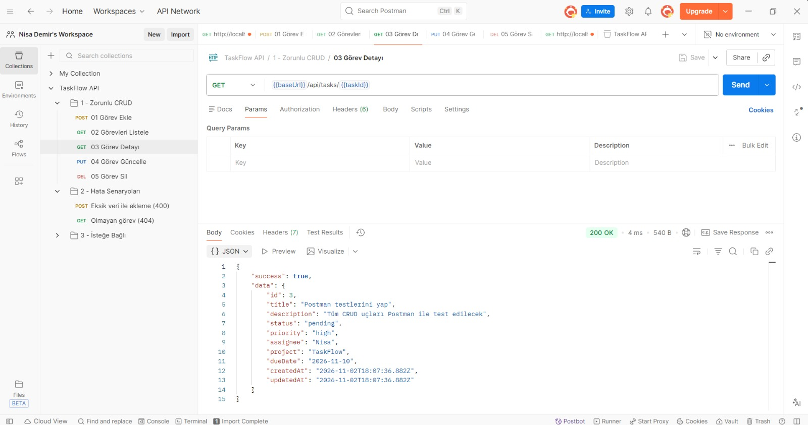
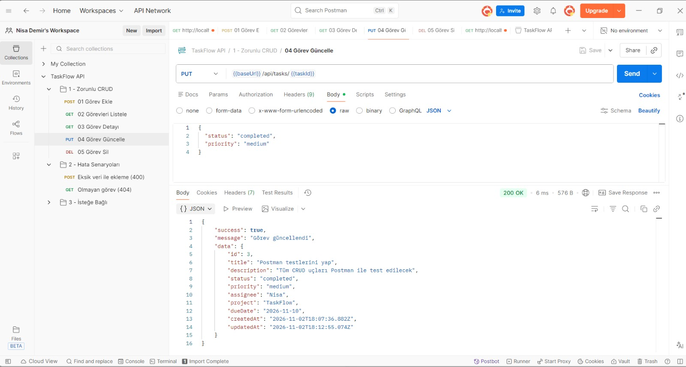
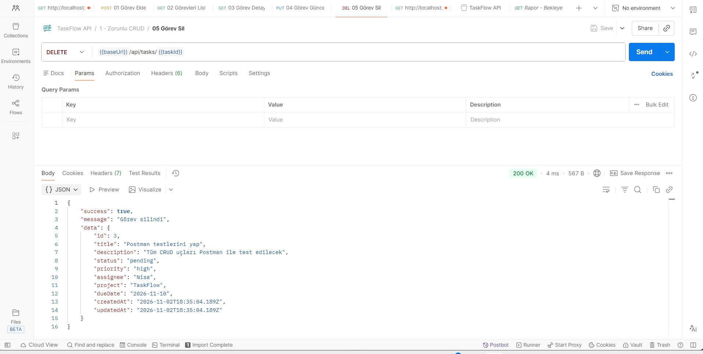

# TaskFlow API

Görev ve Proje Yönetim Sistemi için **Node.js + Express** ile geliştirilmiş REST API.
Görev ekleme, listeleme, detay, güncelleme ve silme (CRUD) işlemlerini destekler;
tüm istekler Logger middleware ile kayıt altına alınır.

> Software Persona — Backend Geliştirme Bitirme Projesi
> Hazırlayan: **Meryem Nisa Demir**

📄 Proje Tanıtım Dokümanı: [docs/Backend_Gelistirme_Proje_Envanteri.pdf](docs/Backend_Gelistirme_Proje_Envanteri.pdf)

## Kurulum

```bash
git clone https://github.com/nisademir1/taskflow-api.git
cd taskflow-api
npm install
npm start
```

Sunucu `http://localhost:3000` adresinde çalışır. Geliştirme için: `npm run dev`

## Klasör Yapısı

```
server.js                  # Sunucuyu başlatır
src/app.js                 # Express uygulaması, middleware ve route bağlantıları
src/routes/                # taskRoutes.js, reportRoutes.js
src/controllers/           # taskController.js, reportController.js
src/middleware/            # logger.js, validateTask.js, errorHandler.js
src/utils/fileDb.js        # JSON dosyasına okuma/yazma
src/data/tasks.json        # Görev verileri
docs/                      # Postman koleksiyonu ve test ekran görüntüleri
```

## API Uçları

| İşlem | Method | Endpoint |
|---|---|---|
| Görev ekleme | POST | `/api/tasks` |
| Görev listeleme | GET | `/api/tasks` |
| Görev detayı | GET | `/api/tasks/:id` |
| Görev güncelleme | PUT | `/api/tasks/:id` |
| Görev silme | DELETE | `/api/tasks/:id` |

**İsteğe bağlı özellikler**

| Özellik | Örnek |
|---|---|
| Filtreleme | `/api/tasks?status=completed`, `?priority=high`, `?assignee=nisa` |
| Sayfalama | `/api/tasks?page=1&limit=10` |
| Arama | `/api/tasks/search?keyword=backend` |
| Raporlar | `/api/reports/completed`, `/pending`, `/summary` |

## Logger

Her istek method, endpoint, zaman damgası, durum kodu ve süresiyle konsola ve `logs/requests.log` dosyasına yazılır:

```
[2026-11-02T18:05:12.345Z] GET /api/tasks → 200 (2 ms)
```

## Postman Testleri

Koleksiyon: `docs/TaskFlow.postman_collection.json`

| Test | Ekran görüntüsü |
|---|---|
| Görev ekleme |  |
| Görev listeleme |  |
| Görev detayı |  |
| Görev güncelleme |  |
| Görev silme |  |